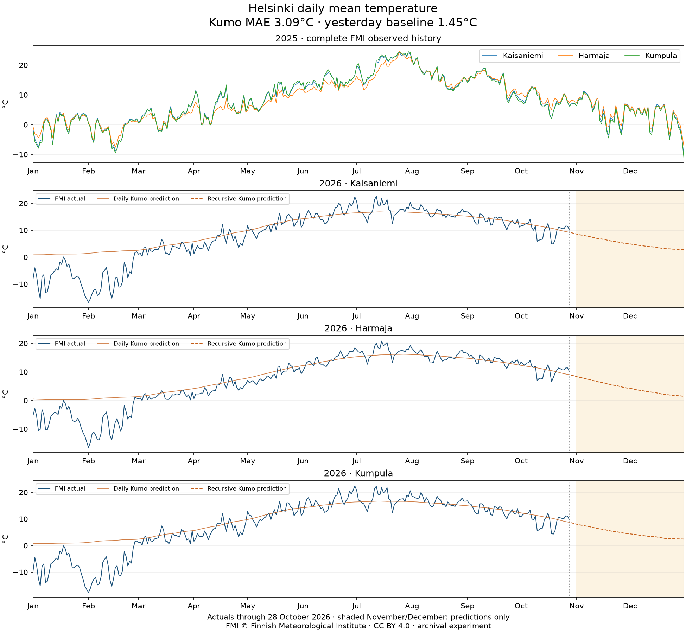

# SnowKumo

Run NVIDIA Kumo Engine in a Snowflake GPU notebook using Helsinki temperature data.
The example connects relational tables, defines a prediction with PQL, fits a graph
neural network, and saves a full year of predictions to Snowflake tables.

**The workflow ran successfully. The model did not beat a simple baseline.**
Across 903 observed station-days in 2026, Kumo's mean absolute error was **3.09°C**;
predicting yesterday's temperature achieved **1.45°C**. This is a three-epoch
experiment, not a weather forecasting service.



Actuals stop on October 28, 2026. Dashed lines show recursive predictions through
December 31; shaded November and December contain no actual observations.
Source: © Finnish Meteorological Institute, [CC BY 4.0](https://creativecommons.org/licenses/by/4.0/).

## Start here

| What you want to do | Read |
|---|---|
| Run the example for the first time | [Tutorial: your first Helsinki forecast](docs/tutorials/first-forecast.md) |
| Run from the CLI, export results, or stop compute | [How-to guides](docs/how-to/operations.md) |
| Fix package, GPU, or split-column errors | [Troubleshooting](docs/how-to/troubleshooting.md) |
| Look up versions, inputs, outputs, and files | [Reference](docs/reference/experiment.md) |
| Understand the evaluation and its limitations | [Method and results](docs/explanation/method-and-results.md) |
| Read the accompanying article | [Medium article source](article/medium.md) |

The documentation follows [Diátaxis](https://diataxis.fr/): learning, practical
tasks, reference, and explanation each have their own place. Examples use short,
progressive explanations inspired by the [FastAPI documentation](https://fastapi.tiangolo.com/python-types/).

## What is included

- A [Snowflake Workspace notebook](examples/helsinki/helsinki_temperature_2026.ipynb)
  with source SQL and a reproducible notebook builder.
- A frozen [FMI input snapshot](data/snapshot-2026-10-28/) and scripts to fetch it again.
- [Prediction CSV, chart, and metrics](results/2026-10-29/) from the completed GPU run.
- Credential-free local checks. GPU training runs in Snowflake.

The example includes all 365 days of 2025 for three stations and predicts all 365
days of 2026. Earlier history, beginning in 2017, supports training. The model uses
2026 observations as each day's history becomes available; it does not retrain daily.
The snapshot is fixed through October 28. No scheduled refresh is installed.

## Check the repository locally

Install [uv](https://docs.astral.sh/uv/getting-started/installation/), then run:

```bash
git clone https://github.com/MiguelElGallo/SnowKumo.git
cd SnowKumo
uv sync --locked
uv run pytest
uv run ruff check .
uv run ty check
uv run python scripts/validate_artifacts.py
```

These commands validate the data boundaries, notebook, and published metrics.
They do not start Snowflake compute or prove a fresh GPU training run.

Adapted from the [Snowflake NVIDIA Kumo guide](https://www.snowflake.com/en/developers/guides/getting-started-with-nvidia-kumo-graph-neural-networks-in-snowflake/).
Code is MIT licensed; FMI data retains its CC BY 4.0 attribution. See
[third-party notices](THIRD_PARTY_NOTICES.md).
