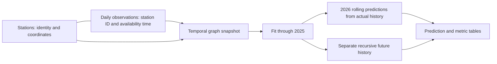

# What the Helsinki experiment shows

Kumo Engine completed GPU training, a full refit, rolling predictions, and a
recursive forecast inside Snowflake. The resulting model was less accurate than
predicting yesterday's temperature. Successful integration and useful prediction
quality are separate results.

## Why use relational learning here?

The input has two natural entities: stations and daily observations. Each observation
belongs to a station. Kumo can use that relationship directly, with a timestamp
that controls when an observation becomes visible.

There are no explicit spatial edges between stations. The model shares parameters
across their histories. This small graph demonstrates the workflow; it is not a
claim that a GNN is the best model for three temperature series.

## How time is handled

The notebook predicts a day's published mean temperature at an archival anchor of
00:00:01 UTC. It assumes a daily observation becomes available at midnight on the
following day. The one-second offset makes the previous day's value earlier than
the anchor. FMI's historical publication and revision times are not known here,
so this is an archival hindcast rather than a replay of operational forecasts.

The initial fit trains on 2018–2023, selects using 2024, and tests internally on
2025. Full refit then includes eligible labels through 2025. The final model is
evaluated on 2026; no 2026 labels participate in fitting or model selection.
Every label requires seven preceding finite calendar-day values. This condition
controls eligibility, not the full temporal sampling range.

For January 1–October 28, the fixed model receives history containing actual
observations available before each anchor. A later observation cannot be sampled
for an earlier anchor. “Update daily” means using that day's available history;
there is no daily retraining or scheduled refresh.

From October 29, actual observations stop. Each new prediction is appended to a
separate history for the next step. The graph snapshot query changes at each
cutoff, avoiding reuse of a stale graph cache. Original observations are preserved.

## Results on the same 903 station-days

| Method | MAE °C ↓ | RMSE °C ↓ |
|---|---:|---:|
| Kumo GNN | 3.0884 | 4.8590 |
| Yesterday's actual (persistence) | **1.4512** | **1.9585** |
| Same calendar day in 2025 | 3.4341 | 4.7648 |

MAE is the average absolute error. RMSE weights larger misses more strongly.
All three rows use identical station/date pairs. Kumo improves MAE over the
previous-year baseline, but has slightly worse RMSE. Persistence wins both metrics
and outperforms Kumo at each station.

Kumo's average signed error is **+1.9323°C**, indicating a warm bias. On 169
subzero actuals, it predicts no subzero values: MAE is **9.4083°C**, compared with
**2.2704°C** for persistence. These failures are visible in the winter portion of
the [chart](../../results/2026-10-29/helsinki_2026_kumo.png).

## What the future curve means

There are 192 recursive predictions from October 29 through December 31,
including 183 in November and December. All their actual values are null.
They are an experimental trajectory from a weak short-run model. Errors can
accumulate as predictions become later inputs. No future accuracy metric or
calibrated uncertainty interval is available.

The run verifies a working path from Snowflake tables to GPU training and back to
prediction tables. Improving its weather accuracy would require another experiment:
investigate the winter bias, strengthen the temporal/spatial inputs, and compare
models over multiple chronological holdouts. More epochs alone are not evidence
of better forecasts.

## Evidence and reproducibility

The published CSV was exported from completed Snowflake run `7A2528115440` on
October 29, 2026. Its full calendar, finite predictions, null future actuals,
and unchanged observation table were verified against Snowflake. Compute was
suspended after the run.

The repository's offline validator independently recomputes the metrics and
checks the committed snapshot. The public notebook preserves the executed
code-cell semantics; packaging changes remove account-specific setup details.
CI does not run a GPU notebook. A new GPU run may differ despite the fixed seed,
and a fresh FMI download may contain revisions. Use the frozen CSVs to reproduce
the input population and compare outcomes honestly.
